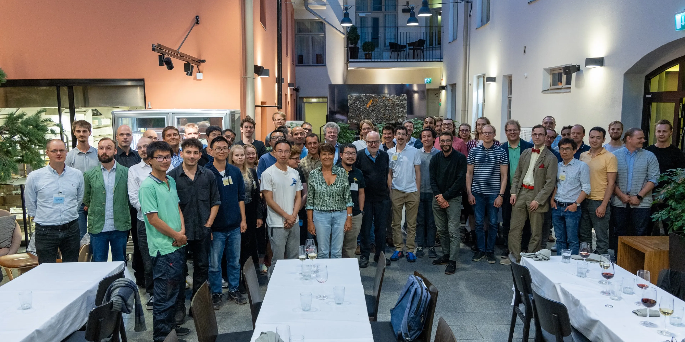

---
title: "My PhD Journey (In Progress)"
author: "Antonio Cocan"
pubDatetime: 2026-11-16T22:00:00+02:00
modDatetime: 2026-11-17T23:15:34+02:00
description: "A (brief) overview of my PhD journey."
tags:
  - academia
  - life
featured: true
draft: false
---

This blog post is about a big part of my life and career: my journey as a PhD student! NOTE: There are still things to flesh out.

## Where the journey began

My early (significant) mathematical journey began perhaps in school at the age when kids learn how to divide numbers via long division (yes very significant!). I must've been eight or nine years old when I first became fascinated by mathematics. I recall that counting, addition, and multiplication were quite easy. Nothing to be fascinated by as a child! However, once we arrived at division, I was mesmerized. I can't particularly put into words what exactly it was about division, but I became obsessed. I recall vividly that I went home and was taking sheets of paper and simply doing long division all the time. Bigger and bigger numbers. I also recall that my head was very fatigued at first since it must've been very demanding to compute such things as a child. But this continuous exercising made me quite good at dividing numbers.

I must say that my elementary school fascination was short lived! I recall that the next fascination that I had was with elementary geometry à la Euclid. However, it is not the kind of fascination that you may expect! Rather than being fascinated by calculating the area of polygons or volumes of polyhedrons, I was more fascinated by shading these areas... The quadratic formula was kind of cool though! I memorized it and was able to wield its power when most of my classmates couldn't!

Fast forward to high school and we were learning about derivatives and integrals. Now we're talking! I recall that the teacher introduced the idea of derivatives via slopes of tangent lines. I thought that it was such a simple and obvious idea that I could've come up with. But why didn't I? This was perhaps my first encounter with the *why* of mathematics rather than just the *do* of mathematics. But this why phase was shortly lived since we were back to memorizing mechanical rules such as derivative rules and applying them over and over and over again... But then a shimmer of hope: integrals. The area under a curve. What a nice concept and idea via approximation of rectangles! I could've come up with this. But again, why didn't I? We then moved on to linear algebra (meaning matrices) and back into the world of mechanical school mathematics. Needless to say school mathematics was tedious and boring with glimmers of hope.

After high school I wasn't sure what to do so I worked some odd jobs here and there -- one day in construction; two months in a factory in an assembly line building brakes for bicycles; and one month in another factory at an assembly line producing plastic cups. This was when I knew that conventional jobs are not for me! So I called my high school friend Karl-Martin, who was studying computer science, and asked him if I could join him for the lectures. And there I was going to university as a non-registered student and going to lectures in computer science. I was determined to become a computer programmer. In my free time I learned C and C++. But there was a course that I attended: basics of mathematics. This was an introductory course to university mathematics for university students. It covered basics of logic, set theory, proofs, some elementary number theory, and some basic combinatorics. It explained everything from start to finish! Unlike the pesky school mathematics. I was hooked and printed out the lecture notes. I studied those notes every day until I knew them inside out. I was ready for university! But since I was poor, I wanted to make lots of money and hence...

## The university era

At university I made a big Big BIG blunder... I enrolled in business, economics, and (ugh I must say it...) marketing! Yes marketing... Let's just say that we all make youthful mistakes and this was mine! After my first year of undergraduates, I began taking courses in mathematics. I wasn't the best student in mathematics but I wasn't the worst either. I was somewhere in the middle. In some courses I did very well and in others I barely passed. I think this may have had to do with the fact that I was learning for the first time to think like an actual mathematician and getting used to the nitty gritty methodologies of mathematicians. It also didn't help that I refused to learn proofs and especially I refused to memorize proofs (I still refuse!). This had the effect that I would discover or replicate proofs in exams. Sometimes this worked and sometimes it didn't. It also certainly didn't help that I was so poor that I could barely put food on the table and I was sleeping on couches of friends. I could not afford to go to university since the mathematics university was far away from where I was located. Hence I had to rely on self-studying and the examiners would send the examination to the closest university where I was located and appoint a local exam supervisor for me. What privilege! I am very grateful to this day for such a great system. I eventually graduated with a BSc in economics and mathematics and was on my way to a masters program in mathematics -- ready to leave behind my youthful sin.

I remember that the first two courses I took at the masters level were Complex Analysis and Abstract Algebra II. Out of twenty-four students, only four of us passed. I was one of them. In fact, in my masters, I was a very good student. I suppose the independent learning and stubbornness to learn proofs and discover them myself was starting to pay off. Towards the end of my degree, I pivoted towards geometry -- differential and algebraic -- and eventually I wrote my thesis in algebraic geometry and algebraic number theory. I then started applying for PhD positions.

I think I applied to about fifty PhD positions and received about ten to fifteen offers. I eventually decided to join the University of Jyväskylä. Jyväskylä... What a funny sounding place I never heard about!

## The PhD era

Having proudly rejected Swansea University in Wales, the University of Vienna in Austria, and Stockholm University in Sweden -- just to name a few -- I was on my way to Jyväskylä in Finland to begin my PhD studies. But first, why did I choose Jyväskylä? Why not Wales? Why not Vienna? Or any of the other offers? To put it simply: the project itself. At Swansea University, the project would've been in pure algebra. A very intriguing project and within an area of mathematics that I enjoy a lot. However, a lot of the financial burden would've been on me (due to Brexit) and the salary wasn't quite enough. Vienna had a project in differential geometry which was intriguing but I wanted to do algebraic geometry or algebra or number theory; and Stockholm was in operator theory. Since analysis is not my most intuitive skill, I decided for a field known as *inverse problems* which frankly I've never heard of before. However, the idea was to use algebraic geometry to solve problems. I was intrigued to say the least. Joonas, my advisor, was very friendly and passionate about mathematics. He also made sure to make my moving very easy and he put much effort into getting me to Finland and helping me financially to make it there.

The first year of grad school was dull: take courses. About two semesters worth of courses. I attended courses in analysis, differential geometry, algebraic topology, and inverse problems. At the same time I was getting involved in research and was going on conferences! The first was Gunther Uhlmann's 70th birthday celebration conference *Inverse problems in analysis and geometry* in Helsinki on August 2022. This was the first conference I attended. Fun fact: Joonas' first conference attendance was Gunther's 60th birthday celebratory conference. The Gods of mathematics surely wanted us together! Nonetheless, here is a picture from that conference:

I then attended my first summer school which was in Jyväskylä. In December a yearly tradition began: *Inverse Days*. The first Inverse Days I attended was in Kuopio; the second in Lahti; the third in Oulu; the fourth in Helsinki; and the fifth before graduation was in Jyväskylä! Poetic isn't it?

But those were not the highlights of my research travelings. Far from it. I went to Paris, France, for a summer school titled *Summer School in Microlocal and Probabilistic Methods in Geometry and Dynamics*. I was at the *Applied Inverse Problems Conference* in Göttingen, Germany. Finally I was ready to leave Europe for the first time in my life to Shanghai, China. I was going to the *International Conference on Inverse Problems Theory and Computation & International Summer School of Modern Mathematics – Inverse Problems* (now that's a mouthful!) at Fudan University. I remembered I was so nervous that I almost quit and wanted to cancel the trip due to anxiety of flying so long. But I maned up and it was one of the best trips. China is very beautiful! The food is amazing. The countryside is peaceful. But there's more!

I was invited by Maarten de Hoop to Rice University in Houston Texas, USA. It was always a dream of mine to visit the United States of America. I received my visa and off I went. The flight was from Helsinki to Miami and from Miami to Houston. To be continued...

However, it was not just travel and no work. To be continued...

## Where the journey led

Currently I am at the end of my PhD journey and I sent my thesis for pre-examination this November. I am looking for postdoctoral positions by contacting mathematicians and on mathjobs[dot]org. Meanwhile I'm also preparing for my thesis defense and looking for [karonkka](#karonkka) venues.

## Thesis defense

In early to mid January. But more on that experience later...

## Karonkka

A <mark style="background-color: #154734; color: #FFFFFF;">karonkka</mark> (Finnish: väitöskaronkka) is an academic tradition. It is a traditional Finnish academic celebration held after a doctoral dissertation defence. It marks the culmination of the doctoral journey and is traditionally organized by the newly graduated doctor in honour of the opponent — the academic who examined and challenged their dissertation.

I have been to three karonkka and I can tell you that it is an event that makes grown men cry! But more on this later...

Regarding the karonkka venue, it is most likely going to be at the *Viking Restaurant Harald*.

## Where the journey will lead

Unknown so far... However, there are some uncertainties. For instance, [Artificial Intelligence (AI) In Mathematics](https://antoniococan.github.io/blogcocan/posts/aiinmaths/) is a threat to mathematicians which we need to take seriously sooner rather than later; especially governments need to get involved rapidly and develop protective measures.

## Epilogue

